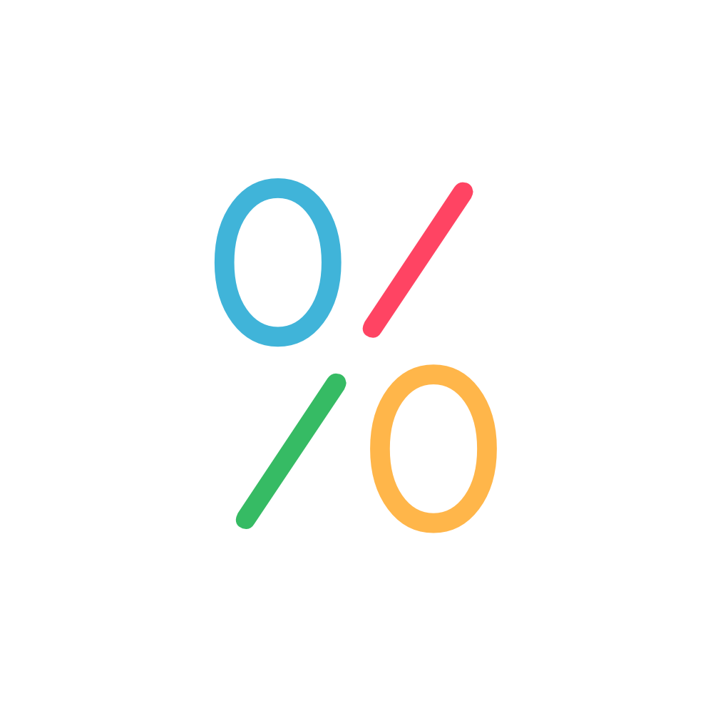

<p align="center">
  
</p>

<h1 align="center">Hits</h1>

<p align="center">A leaderboard for app installs on Urbit.</p>

---

Hits is an Urbit app that ranks other apps by how many installs they have
among the ships around you. Each ship gossips a small message — a *hit* —
whenever it installs or uninstalls an app, and counts the hits it hears so
it can show a live leaderboard. There is no central server: the ranking is
assembled on your own ship from the ships you already talk to.

## How it works

- **Who you hear from.** Hits gossips with your [Pals](https://github.com/urbit/pals)
  and with the ships you chat with in Tlon (direct messages and small group
  DMs), and relays hits a couple of hops further, so the sample grows with
  your social graph rather than the whole network.
- **Pals is optional.** Hits checks whether `%pals` is running before each
  read, and its watches on `%pals` simply wait until it starts. Without Pals,
  you hear only from the ships you chat with in Tlon. To get Pals:
  `|install ~paldev %pals`.
- **What counts as an install.** Hits counts an app only while kiln syncs it
  from another ship. Apps installed from a file (for example with deskjam)
  and desks made with `|new-desk` have no sync source, so they are never
  counted. Pausing a desk's sync (`|pause`, which is what deskjam's "stop
  kiln syncing" does) makes Hits treat the app as uninstalled, and it
  gossips an uninstall.
- **Counting.** A hit is `[time app kelvin installed]`. The `time` identifies
  one install, so the same install is counted once no matter how many times
  it is re-sent. An app's score is its number of distinct installs.
- **Two views.**
  - **Trending** weights recent installs more heavily (each install decays
    over 24-hour periods).
  - **All-time** ranks by total installs.
- **Docket.** For each ranked app Hits reads the publisher's docket (title,
  icon, description, version) so the leaderboard can link you straight to
  installing it.

## How this fork differs from upstream

This is a fork of [urbit/hits](https://github.com/urbit/hits), reworked to
run on the current kernel, serve everything from the ship, and hold up
against bad input. The main differences:

- **Kernel.** Ported to the `408k-2` kernel (`%zuse 408`); upstream targets
  `%zuse 411`.
- **Served entirely from the ship.** The frontend ships as a glob distributed
  over Ames from `~donmec-sallud`, and the app's icon is embedded directly in
  the docket as a `data:` URL. Nothing is loaded from a CDN or external host
  at runtime.
- **Wider reach.** Gossips with the ships you chat with in Tlon (DMs and small
  group DMs), on top of your Pals.
- **Cleaner leaderboard.** Hides infrastructure desks (`%neo`, `%groups`,
  `%webterm`) from the UI, and fixes score rendering.
- **Correct counting across versions.** Installs are told apart by a stamped
  time, so an install is counted once even as ships upgrade, and an uninstall
  can't wrongly drop another ship's install.
- **Hardened against crashes and stalls.** Every peer- or publisher-controlled
  value is bounded, so eyre's JSON rendering can't crash or go quadratic; the
  leaderboard is no longer re-sorted on every hit; and the docket's website and
  path fields are capped.
- **Sturdier UI.** Resubscribes after a drop, re-lists correctly after a kernel
  upgrade, and defaults to the Trending view.

## Repository layout

| Path | What it is |
|------|------------|
| `desk/` | The `%hits` Gall agent, marks, and structures (Hoon) |
| `desk/app/hits.hoon` | The agent: scanning, counting, gossip, docket reads |
| `desk/lib/hits.hoon` | Shared helpers: install-time stamping and bounds |
| `desk/lib/gossip.hoon` | Rumor relay layer over Pals |
| `ui/` | The React frontend, built into the app's glob |
| `flake.nix` | Builds the `%hits` desk reproducibly |

## Building with Nix

The desk is built reproducibly with a flake. No global tools are needed
beyond Nix with flakes enabled (`--extra-experimental-features 'nix-command
flakes'` if they aren't on by default).

```sh
nix build
```

`./result` is then a symlink to the finished desk. The build:

- copies `desk/` (the agent, marks, structures, docket, and `sys.kelvin`);
- lays over it the four base marks — `hoon`, `kelvin`, `noun`, `txt` — that
  `|new-desk` normally copies from `%base`, taken from the kernel pinned as
  the `urbit` flake input.

That `urbit` input (`github:urbit/urbit/408k-2`) must stay in step with
`desk/sys.kelvin` (`%zuse 408`). To move to a different kernel, change both
together and run `nix flake update urbit`.

Build for a specific platform with `nix build '.#packages.<system>.desk'`
(for example `aarch64-darwin`, `x86_64-linux`, or `aarch64-linux`).

### The frontend glob

The UI is built separately and uploaded as the app's glob:

```sh
cd ui
npm ci
npm run build
```

`npm run dev` runs the UI against a running ship for local development.

## Installing on a ship

1. Build the desk and the glob as above.
2. Mount and replace `%hits` with the built desk. Vere cannot delete files in
   a mount, so swap in a *writable* copy, then commit:
   ```sh
   find <pier>/hits -mindepth 1 -delete
   cp -R result/. <pier>/hits/ && chmod -R u+w <pier>/hits
   ```
   In the ship's dojo: `|commit %hits`
   (For a pier on another machine, see the rsync note in `flake.nix` —
   macOS rsync ignores `--chmod`.)
3. Upload the built UI glob through the docket, then publish:
   ```
   |public %hits
   ```

On a ship other than `~donmec-sallud`, installing Hits from a file (for
example with deskjam) leaves it without a frontend: the docket's
`glob-ames+[~donmec-sallud 0v0]` is a placeholder. That ship can serve its
own copy by clicking **set** in deskjam's glob box, then uploading the built
`ui/dist` at `/docket/upload`.

## License

MIT. See [`desk/LICENSE`](desk/LICENSE).

Forked from [urbit/hits](https://github.com/urbit/hits).
